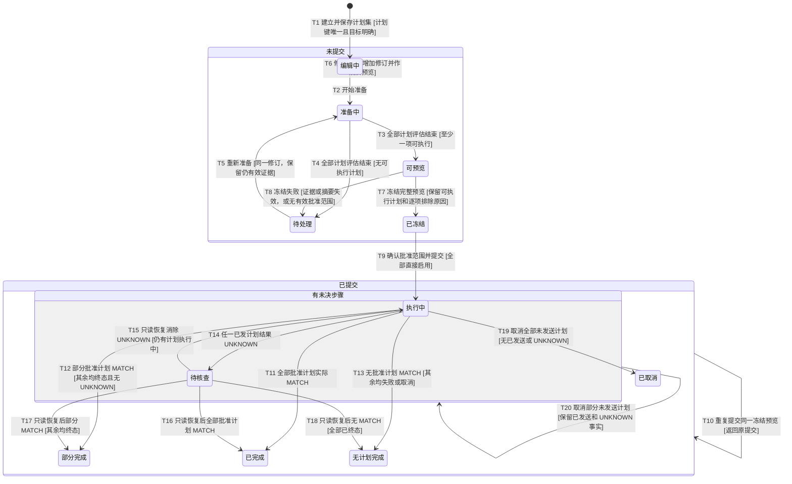

# M2：原生 Series 多计划批量新建 Spec

状态：已定稿。用户已确认验收 Seam 与批次边界；实施前需按本 Spec 验收。

## Problem Statement

投手已经能用 M1 为“一个目标账户 × 一个精确 Series 资产 × 一套双身份 × 一组地区”完成直接视频广告闭环，但同一经营计划要投多套身份、多个 Series 资产或多个账户时，只能重复建草稿、重复准备和重复提交。这样既慢，也难以在提交前比较各计划的实际广告展开、地区冲突和总预算；一旦部分计划失败，还难以区分哪些已创建、哪些未创建、哪些必须只读核查。

M2 需要让投手在一个既有构建工作区里显式配置多份投放计划，看到每份计划的真实展开与排除原因，只批准明确列出的范围，并获得逐计划和整批一致的结果。系统不能按同名合并资产，不能未经选择把资产隐式扩展到整个账户池，也不能把单计划失败、重复点击或 UNKNOWN 变成重复创建或虚假的全批成功。

## Solution

在同一 Draft、同一既有策略、同一冻结执行路由和同一冻结预览流程中引入“计划集”。每份计划有稳定的 `plan_key`，并且只指定一个精确目标账户、一个精确 Series ID、分开的 Series 承载身份与创意展示身份、一组地区和视频来源；同一 Series 要投另一个账户时，由投手再添加或显式复制一份计划并选定账户。目标账户必须处于该工作区冻结路由的当前授权范围内；跨执行连接不是 M2 的隐式扩展。策略仍在 Draft 级配置，并独立应用到每份计划，不增加每计划策略覆盖。

准备阶段逐计划复用 M1 的路由、账户能力、双身份、精确资产、地区、视频和封面证据。每份计划分别得到 READY、BLOCKED 或 UNVERIFIED；一项不可执行不会隐藏其他可执行计划。冻结预览列出所有已选计划：可执行计划完整展开 Campaign、广告组、实际广告、创意、素材、文案、CTA、地区和预算；被排除计划显示具体原因，但不生成伪造的可执行展开。没有可执行计划时不能提交。

资产、身份、地区或素材资格未验证时，该计划不可执行；这与占用覆盖未知是不同事实。对批内重复、地区交集和当前账户可见占用分别判定：批内同账户、同 Series 且地区相交的已知冲突排除所有受影响计划，当前账户目录中确定的 ACTIVE 交集只排除其覆盖计划。占用结果为 PARTIAL、STALE 或 UNKNOWN，或者未覆盖其他账户/BC 时，必须如实展示观察范围、时间和限制，不能声称“全域无冲突”；但在没有确定 ACTIVE 交集且其他资格均 READY 时，不据此全局禁投，该计划仍可进入明确预览和批准，由平台最终判定。跨账户不得仅凭同 Series 自动判冲突，也不得承诺跨账户/BC 唯一性。

投手确认的批准范围就是冻结预览中的 INCLUDED 计划；EXCLUDED 计划始终可见且不计入批准范围或总预算。要更改范围，必须修改 Draft 并重新冻结，不能在提交时暗中改变范围。提交后复用既有 Submission、SubmissionUnit、ExecutionStep、恢复和回读链路，所有对象直接 ENABLE，没有第二激活步骤。整批状态由逐计划实际结果派生，成功对象不重试重建，UNKNOWN 只读恢复，取消仅作用于尚未发送的本地步骤。

## Business Flow



未列出的转移一律禁止。T10 的“已提交”父状态覆盖执行中、待核查及全部终态，因此重复提交只返回原 Submission 和当前回执，不产生额外远程写。T20 只改变尚未发送的本地步骤；取消后仍按图中 T11–T18 的实际 MATCH、失败和 UNKNOWN 条件派生结果，不增加图外跳转。每个 T 和 R 都是这个 MMF 的 MR 验收项。

* R1：每份计划由稳定计划键和精确账户、Series ID、双身份、地区及视频来源定义；同名不等于同 ID，同一业务剧目下的不同身份资产不得合并。
* R2：只执行逐计划显式账户分配；禁止未经选择的“所有资产 × 所有账户”隐式扩量和自动换用同身份。显式复制计划、批量编辑共同字段等便利操作可以使用，但必须显示受影响计划、落成逐计划映射并由用户审阅，不能替用户默认选择整个账户池。
* R3：同一账户、同一 Series ID 且地区有交集的批内计划是已知冲突，所有受影响计划均排除；当前账户可见 ACTIVE 占用只排除其覆盖到的计划。地区不相交不是冲突；跨账户不得仅凭同 Series 判定冲突，也不得声称跨账户/BC 全局唯一性已经核实。
* R4：只有资产、身份、地区和逐素材资格 READY 且无确定 ACTIVE 交集的计划可以 INCLUDED；资格 BLOCKED/UNVERIFIED 或已知 ACTIVE 冲突必须显示原因并 EXCLUDED。占用覆盖 PARTIAL/STALE/UNKNOWN、ACTIVE 状态未知或跨账户/BC 范围未知必须保留风险提示，不能冒充无冲突，但在没有确定 ACTIVE 交集时不单独构成全局排除；其他资格 READY 的计划仍可明确预览和批准。
* R5：冻结摘要绑定完整计划集、每份计划的选择、路由、资格证据、占用观察及范围限制、素材顺序、策略、实际分配、CTA、包含/排除结果及预算；任何配置或范围变化都必须产生新 Draft revision 和新预览，已提交预览不得改写或再生成。
* R6：每份计划使用由 Draft、revision 和计划键派生的稳定种子，复用固定/按素材基础广告、SHARED/SEQUENTIAL_AVERAGE、基础广告 × creative_count 和文案候选池 seed 抽样；顺序或并发不得改变分配，不得恢复 50×5 网格、固定两广告或全视频 × 全文案。
* R7：每份 INCLUDED 计划的 CBO Campaign 预算只计算一次，绝不乘广告数；批次预算是各 INCLUDED 计划预算的 Decimal 精确求和，EXCLUDED 不计入，禁止二进制浮点误差。
* R8：同一冻结预览只能有一个 Submission；重复或并发提交必须返回原提交，不同请求键不得为同一预览另建执行范围。
* R9：每份 INCLUDED 计划有独立 Unit、write-once ExecutionStep 和稳定幂等键；一个计划失败不得撤销或伪装其他计划结果，已成功对象不得因其他计划重试而重建。
* R10：UNKNOWN 只能按原请求指纹、账户、计划键和幂等键只读查找唯一实际匹配；零个或多个候选、证据不足或仍 UNKNOWN 时保持待核查，禁止盲重发。
* R11：取消只影响尚未发送的本地 PENDING 步骤；不能撤回已发送请求或远程对象，存在 UNKNOWN 时不得借取消退出待核查。
* R12：每次入队和物理发送前都必须复核当前 tenant、BC、工作区冻结路由、该计划账户授权与操作者代数、Draft revision、冻结摘要和原步骤请求体；旧准备完成、旧 worker、重复投递或旧授权消息不得触发新写。
* R13：单计划完成必须满足 Campaign、广告组、广告三层和逐创意实际 MATCH；整批“已完成”只表示全部 INCLUDED 计划完成，“部分完成”表示至少一项 MATCH 但并非全部 INCLUDED 完成，EXCLUDED 不计成功且必须持续可见，UNKNOWN 阻止任何成功终态。“无计划完成”只表示没有完整 MATCH 的计划，不表示未创建任何远端对象；已创建的 Campaign、广告组或部分广告 ID、消耗风险和逐项结果必须保留展示。

## User Stories

 1. As a 投手, I want to add multiple exact Series plans to one existing build workspace, so that I can prepare one operating batch without recreating equivalent drafts.
 2. As a 投手, I want to choose exactly one target account for each plan, so that every account assignment is intentional and auditable.
 3. As a 投手, I want to add or explicitly copy a plan and choose its account when the same Series should run elsewhere, so that convenience does not become an unreviewed Cartesian product.
 4. As a 投手, I want to bulk-edit common fields for explicitly selected plans, so that repetitive configuration is efficient without hiding any account, asset or region assignment.
 5. As a 投手, I want separate plans for different identities and Series IDs belonging to the same business drama, so that same-name assets are never merged.
 6. As a 投手, I want series-hosting and creative-display identities to remain separate in every plan, so that the system does not silently replace one role with the other.
 7. As a 投手, I want to choose a region set and video sources for each plan, so that one asset can have independently configured delivery plans.
 8. As a 投手, I want preparation to retain still-valid evidence when I retry the same revision, so that one blocked plan does not force unrelated plans to start over.
 9. As a 投手, I want per-plan READY, BLOCKED and UNVERIFIED qualification results, so that I understand exactly what can and cannot proceed.
10. As a 投手, I want blocked or unverified plans to remain visible with reasons, so that their omission from an approved scope is never silent.
11. As a 投手, I want same-account, same-Series plans with intersecting regions to be identified before submission, so that I do not create mutually exclusive active Campaigns.
12. As a 投手, I want plans with disjoint regions to remain eligible, so that conflict handling does not impose an unsupported global one-asset restriction.
13. As a 投手, I want a definite visible ACTIVE overlap to exclude only the affected plan, so that a real conflict does not erase otherwise valid work.
14. As a 投手, I want partial, stale or unknown occupancy coverage shown with its scope and observation time, so that I do not mistake limited evidence for a global safety claim.
15. As a 投手, I want a qualified plan with no definite ACTIVE conflict to remain previewable and approvable even when occupancy coverage is partial or unknown, so that missing cross-account evidence does not permanently block all delivery.
16. As a 投手, I want cross-account and BC uncertainty shown as a scope limitation rather than proof of uniqueness, so that I can make an evidence-based approval while the platform remains the final authority.
17. As a 投手, I want every eligible plan’s Campaign, ad group, ads, creatives, material order, copy and CTA fully expanded before approval, so that I approve actual content rather than a row count.
18. As a 投手, I want stable seeded allocation for each plan, so that reordering, regeneration protection or concurrent workers cannot unexpectedly change the approved ads.
19. As a 投手, I want existing fixed/per-material and SHARED/SEQUENTIAL_AVERAGE strategies reused, so that M2 does not introduce a new allocation doctrine.
20. As a 投手, I want each plan’s CBO budget and the exact included-plan total shown together, so that I can approve spend without multiplying budget by ad count or including blocked plans.
21. As a 投手, I want the confirmation dialog to name the included and excluded plan counts, occupancy limitations and direct ENABLE behavior, so that there is no hidden scope change or second activation.
22. As a 投手, I want repeated submission clicks and retries to return the same Submission, so that network or UI repetition cannot duplicate a batch.
23. As a 投手, I want per-plan progress and receipts alongside an aggregate status, so that I can see which accounts and assets actually succeeded.
24. As a 投手, I want one plan’s failure to produce a partial result without rolling back or recreating other plans, so that partial success remains truthful and recoverable.
25. As a 投手, I want UNKNOWN results to enter read-only reconciliation and remain unresolved when no unique match exists, so that recovery never blind-resends a create request.
26. As a 投手, I want to cancel only unsent local steps, so that cancellation does not pretend to undo remote advertising objects or hide an UNKNOWN result.
27. As a 投手, I want edits after freezing to invalidate the old preview, so that no stale configuration can be submitted under a new intention.
28. As a 投手, I want revoked account, route or actor authorization to block the affected physical send, so that an old queued message cannot keep writing.
29. As a 投手, I want completion based on three-level and per-creative actual MATCH, so that HTTP success alone cannot mark a plan or batch complete.
30. As an 审核者, I want the frozen manifest to preserve included and excluded plans with evidence, occupancy limits and reasons, so that I can reconstruct exactly what was approved and what remained unknown.
31. As a 租户管理员, I want every plan to retain tenant, BC, route and account scope, so that batch execution cannot leak access across workspaces.

## Implementation Decisions

本 MMF 不新建 Module；删除测试为 N/A，因为没有可删除的新 Module。设计通过深化现有 Workspace、Native Readiness、Native Preview、Frozen Request、Submission/Execution 和 Recovery/Readback Module 完成，不增加浅层批次壳、第二执行器、第二上传器或第二资格同步器。

用户已确认共享 Draft 策略和单一冻结 Workspace 执行路由；跨连接分成不同批次。这是本片交付边界，不是官方平台规定。

### 1. Build Workspace Module（修改）

Owns：T1、T6；R1、R2。Participants：R1 → Native Series Readiness；R2 → Native Series Readiness。

Interface：

```python
class NativeSeriesPlan(BaseModel):
    plan_key: UUID
    selection: NativeSeriesSelection  # 复用 M1 的单计划精确选择

class NativeSeriesPlanSet(BaseModel):
    kind: Literal["NATIVE_SERIES_DIRECT_VIDEO"]
    plans: list[NativeSeriesPlan]

def create_draft(session, *, context, request_id: UUID, body: CreateDraftRequest) -> DraftDetail: ...
def update_draft(session, *, context, draft_id: UUID, body: PatchDraftRequest) -> DraftDetail: ...
```

Ensures：

* `plans` 至少一项且 `plan_key` 在 Draft 内唯一；每项仍由 M1 `NativeSeriesSelection` 要求一个账户、精确 Series、双身份、非空唯一地区和视频来源（R1、R2）。
* 服务端不使用旧 Mini `account_lines`/剧单做原生扩展。UI 可提供“添加计划”“显式复制计划”和对已选计划批量编辑共同字段；每项操作都显示受影响计划并落成逐计划账户/资产/地区映射，不默认执行全资产 × 全账户扩量（R1、R2）。
* 每次修改增加 revision 并完整改变意图摘要；旧预览和旧准备结果不能代表新 revision（R5）。所有读写保持 tenant/BC scope（R12）。
* 同一 Workspace UI Adapter 展示逐计划编辑器、完整冻结预览、批准范围、占用限制、总预算和逐计划回执；直接 ENABLE 文案在确认前可见。

Seam：复用现有 Build Workspace HTTP API 与 Draft service；不新增 batch HTTP 入口。

数据形状决定：禁止在旧平铺 `NativeSeriesSelection` 旁再增加可选 `plans` 或 `is_batch`，否则会形成两个必须同步的真相。持久化 canonical shape 只有 `NativeSeriesPlanSet`；旧 M1 平铺输入和旧持久化 JSON 在边界规范化为单项计划集，scene 类型不变。`plan_key` 是技术身份，不从名称或资产 ID 推导合并关系。显式复制/批量编辑只是生成或修改 canonical 计划的工作区命令，不引入第二份映射真相。

### 2. Native Series Readiness Module（修改）

Owns：T2、T3、T4、T5。

Interface：

```python
class ReadyNativePlan(BaseModel):
    state: Literal["READY"]
    plan_key: UUID
    checkpoint: NativeCheckpoint

class UnavailableNativePlan(BaseModel):
    state: Literal["PENDING", "BLOCKED", "UNVERIFIED"]
    plan_key: UUID
    selection: NativeSeriesSelection
    reason_codes: list[str]

NativePlanReadiness = Annotated[
    ReadyNativePlan | UnavailableNativePlan,
    Field(discriminator="state"),
]

class NativeSeriesBatchCheckpoint(BaseModel):
    draft_revision: int
    plans: list[NativePlanReadiness]

def evaluate_native_plan_set(session, *, context, draft, selection: NativeSeriesPlanSet,
                             route: FrozenTikTokRoute) -> NativeSeriesBatchCheckpoint: ...
def native_checkpoint(session, *, context, draft, route: FrozenTikTokRoute,
                      plan_key: UUID) -> NativeCheckpoint: ...
```

Ensures：

* 每个 READY 项都由现有 `ensure_scene_preparation`、`native_checkpoint` 和 `prepare_native_materials` 完成同一条“工作区冻结路由 → BC/OAuth → 完整身份目录 → 精确资产 → 联合身份证据 → 地区 → 素材 → checkpoint”链；不得新增资格推断或身份替换（R1、R2、R4）。
* 每项保存自己的账户范围、证据代数、观察时间和有序素材映射；同 revision 重试可复用仍有效项，旧 revision 的异步完成不得覆盖新结果（R12）。
* `native_checkpoint` 只接受 Draft 中对应计划键的选择，并复核其素材和地区与冻结请求一致；聚合结果不得把一个计划的 READY 借给另一计划，也不得把占用覆盖 UNKNOWN 改写成资格 UNVERIFIED（R4）。

Seam：复用现有 Draft prepare/continue、SceneJob 和 checkpoint reader；测试从 Workspace 触发，不直接伪造 READY 数据库行。

数据形状决定：`NativePlanReadiness` 是逐项可判别联合，`plans` 只是该联合的列表；不能把 discriminator 直接写在未包装的列表联合字段上。READY 与不可用计划不以 `state` 搭配可空 checkpoint 形成非法组合；不新增需要同步的 `batch_ready` 布尔值，整批可预览性由逐项结果派生。现有原生素材准备状态扩展为按计划键分隔的条目，每项独立保存游标、素材映射和 scope basis；底层 SceneJob 与素材任务仍按精确账户和资产复用。

### 3. Native Series Preview Module（修改）

Owns：T7、T8；R3、R4、R6、R7。Participants：R4 → Native Series Readiness；R6 → Frozen Request；R7 → Frozen Request。

Interface：

```python
class VisibleOccupancy(BaseModel):
    remote_id: str
    locations: list[str]
    state: Literal["ACTIVE", "INACTIVE", "UNKNOWN"]

class OccupancyObservation(BaseModel):
    visible_conflicts: list[VisibleOccupancy]
    coverage: Literal["PARTIAL", "STALE", "UNKNOWN"]
    observed_at: datetime | None
    scope_limits: list[str]

def generate(session, *, context, draft) -> UUID: ...
def observe_occupancy(session, *, context, bc_id: str, selection: NativeSeriesSelection,
                      location_ids: list[str], route: FrozenTikTokRoute) -> OccupancyObservation: ...
def summary(session, *, context, preview) -> PreviewSummary: ...
```

Ensures：

* 先对完整计划集做批内精确键冲突矩阵，再对每项复用当前账户可见占用观察；批内冲突排除所有相互冲突项，外部确定 ACTIVE 只排除实际覆盖项（R3）。
* 资格非 READY 或存在确定 ACTIVE 交集的计划 EXCLUDED；PARTIAL/STALE/UNKNOWN 覆盖、状态 UNKNOWN 或跨账户/BC 未覆盖必须进入该计划的 `scope_limits` 和预览提示，但在无确定 ACTIVE 交集时不自动排除其他资格 READY 的计划（R4）。不得把“未观察到”写成“全域无冲突”。
* 每项 INCLUDED 计划生成一个 BuildUnit 和一份独立 `FrozenRequestRevision`；EXCLUDED 只进入 manifest 和原因视图，不生成可执行 Unit、步骤或虚假广告展开（R4）。若新冲突只影响部分计划，其他 READY 项仍可冻结；只有证据/摘要失效使事务不可靠或没有任何有效批准范围时才走 T8。
* 每项种子为 `sha256(draft_id:draft_revision:plan_key)`，每项只应用一次现有策略和结构分配；Campaign 名称包含稳定计划键，不能按同名合并（R6）。
* `BuildPreview.budget` 与摘要中的批次总额等于 INCLUDED 项预算的 Decimal 和；每项 Campaign 保持自己的 CBO 预算，摘要同时返回逐项预算、INCLUDED/EXCLUDED 数量和全部已选计划数（R7）。
* manifest、每份请求、每份 Unit 快照和总摘要在同一事务冻结；任一项不一致即整份预览不可提交（R5）。每份 Unit 的账户和 `connection_id` 必须与该计划请求及工作区冻结路由一致（R12）。

Seam：复用现有 `generate_preview`、原生 preview summary 和持久化预览事务；不创建第二展开器。

数据形状决定：资格状态与占用观察是两个字段，不能把覆盖 UNKNOWN 折叠成资格 UNVERIFIED，也不能增加 `occupancy_complete` 与 coverage 同步的第二个布尔值。完整请求的唯一执行真相在各 INCLUDED BuildUnit 的原生快照；预览配置只保存带每请求摘要的 batch manifest，不再同时保存一批可变的完整请求副本。旧 M1 单请求在读取边界规范化为一项 manifest。

### 4. Frozen Request Module（修改）

Owns：R5。Participants：R5 → Build Workspace、Native Series Preview、Build Submission / Execution。

Interface：

```python
class FrozenNativePlanBase(BaseModel):
    plan_key: UUID
    selection: NativeSeriesSelection

class IncludedNativePlan(FrozenNativePlanBase):
    inclusion: Literal["INCLUDED"]
    request_digest: str
    budget: Decimal
    occupancy: OccupancyObservation

class ExcludedNativePlan(FrozenNativePlanBase):
    inclusion: Literal["EXCLUDED"]
    reason_codes: list[str]
    occupancy: OccupancyObservation | None

NativePlanManifestItem = Annotated[
    IncludedNativePlan | ExcludedNativePlan,
    Field(discriminator="inclusion"),
]

class NativeSeriesBatchManifest(BaseModel):
    schema: Literal["native-series-batch-v1"]
    draft_revision: int
    plans: list[NativePlanManifestItem]
    included_budget: Decimal

def native_batch_digest(manifest: NativeSeriesBatchManifest,
                        requests: list[FrozenRequestRevision]) -> str: ...
def native_request_digest(value: FrozenRequestRevision) -> str: ...  # M1 现有
```

Ensures：

* INCLUDED 的 `request_digest` 必须唯一对应同计划键的完整冻结请求；EXCLUDED 不得存在请求摘要或可执行 Unit（R5）。
* 总摘要覆盖 manifest、所有完整请求、计划顺序、每计划种子与分配、包含/排除原因、占用观察和精确预算；顺序变化可产生新摘要，但不得改变单计划已确定的 seed 分配（R5、R6）。
* Decimal 继续经现有精确数规范化，批次求和不得先转 float（R7）；提交去重使用同一份不可变摘要（R8）。

Seam：复用现有冻结请求纯函数和 `BuildPreview.content_digest` 校验点；这是现有低层 Interface，仅增加 batch 纯函数，不新增远程 Adapter。

数据形状决定：`NativePlanManifestItem` 是逐项可判别联合，`plans` 是该联合的列表， discriminator 不直接用于列表字段。INCLUDED/EXCLUDED 不用 `included` 布尔值搭配可空请求摘要或原因列表；批次状态不另存同步标志。占用观察随 INCLUDED 项保存，EXCLUDED 项在已经取得观察时也可保存证据，但资格失败不要求伪造占用结果。

### 5. Build Submission / Execution Module（修改）

Owns：T9、T10、T11、T12、T13、T14、T19、T20；R8、R9、R11、R12。Participants：R8 → Frozen Request；R9 → Recovery / Readback；R12 → Build Workspace、Native Series Readiness、Native Series Preview、Recovery / Readback。

Interface：

```python
def submit_preview(session, *, context, preview_id: UUID, request_id: UUID) -> SubmissionReceipt: ...
def validate(session, *, context, preview, unit, route: FrozenTikTokRoute,
             refreshing: bool = False) -> FrozenRequestRevision: ...
def verify_unit_route(session, *, context, unit, capability: Capability) -> FrozenTikTokRoute: ...
def dispatch_submission(session, *, context, submission_id: UUID) -> None: ...
def cancel_submission(session, *, context, submission_id: UUID) -> SubmissionReceipt: ...
def get_submission(session, *, context, submission_id: UUID) -> SubmissionView: ...
```

Ensures：

* 提交只展开 manifest 中 INCLUDED 且有完整请求的 Unit；EXCLUDED 永不产生 ExecutionStep。重复/并发提交按 tenant + preview 返回同一 Submission（R8）。
* 原生 `validate` 改为以当前 Unit 为上下文，核对它在 batch manifest 中的计划键、请求摘要、整批摘要、Draft revision、当前资格证据和占用观察；不再假定一份预览只有一个 Unit 或一个账户（R5、R9）。复核发现新的确定 ACTIVE 交集时只阻止受影响计划；覆盖不足仍保留限制提示，不伪造全域安全。
* 所有原生计划沿用工作区唯一冻结路由；`verify_unit_route` 继续核对该路由、Unit 连接和当前计划账户的 build 权限。不同账户的授权代数分别复核，但不允许某一计划暗中换用另一执行连接（R12）。
* 每计划沿用 CTA → Campaign → 广告组 → 广告链、稳定幂等键和 write-once 请求体；任何已 SUCCEEDED/UNKNOWN 步骤不得因兄弟计划或重复 worker 重建（R9、R12）。
* 聚合状态只由 INCLUDED Unit 的实际终态派生；UNKNOWN 强制待核查，取消只取消 PENDING 且未发送步骤（R11、R13）。回执逐项返回计划键、账户、Series、状态、原因和远程 ID（R13）。

Seam：复用现有 preview submit、Submission expansion、Execution dispatch、cancel 和 receipt API；TikTok 仍只经现有 OfficialTikTokGateway，外部测试替身位于 SDK transport。

数据形状决定：不增加独立 `batch_status` 字段与 Unit 状态同步；聚合是逐计划状态的纯派生。取消也不增加“整批已取消”远程标志。

### 6. Recovery / Readback Module（修改）

Owns：T15、T16、T17、T18；R10、R13。Participants：R13 → Build Submission / Execution。

Interface：

```python
def process_reconciliation(*, database_engine: Engine, redis_client: Redis,
                           context: TenantContext, step_id: UUID, revision: int) -> ReconciliationResult: ...
def get_recovery(session, *, context, recovery_id: UUID) -> RecoveryReceipt: ...
def get_submission_events(session, *, context, submission_id: UUID,
                          step_id: UUID | None = None) -> Page[SubmissionEventPublic]: ...
```

Ensures：

* 原 UNKNOWN 步骤的查询指纹核对计划键，且只使用该 Unit 的账户、工作区冻结路由、授权代数和原请求体；恢复扫描绝不创建新对象（R10、R12）。
* 零个、多个或事实不完整的候选均不能 MATCH；已确认的唯一结果写回原步骤和原 Unit，不能改挂到兄弟计划或重建已成功对象（R9、R10）。
* 只有该计划三层及逐创意全部 MATCH 才完成该 Unit；批聚合读取同一组实际事实，UNKNOWN、排除项和失败项不得被吞成整批成功（R13）。

Seam：复用现有 recovery/reconciliation、submission events 和实际只读回读接口；不新增 batch recovery worker。

数据形状决定：恢复结果继续写回原 ExecutionStep/Unit；不增加一份可能不同步的“批次恢复结果”副本，视图只聚合原事实。

## Testing Decisions

好测试只观察外部行为：用户输入的计划集、冻结预览、批准范围、实际官方请求、逐计划回执和可见错误；不断言内部 helper 调用次数、私有变量或实现分支。除冻结纯函数的性质测试外，只使用一个主 Seam：现有 Build Workspace HTTP API，连接真实应用、隔离 PostgreSQL/Redis 和真实任务调度；只把官方 SDK transport 替换为可编程 double。取消、恢复和回读也从同一工作区/Submission API 进入。另做一次真实浏览器验收，沿用同一后端和 Seam，不建立平行 batch API。

Prior art：现有原生预览冻结、六步直接创建、提交并发、write-once 执行、UNKNOWN 只读恢复、逐创意回读、迁移兼容和真实浏览器验收测试。新用例扩展这些套件，不重写 M1 已通过的单计划用例。

### T 覆盖

| 转移 | 通过主 Seam 的验收 |
| -- | -- |
| T1 | 建立多计划及重复计划键；合法项保留精确字段，重复键返回可见校验错误。 |
| T2 | 从 Draft 开始准备，观察到每项独立准备结果，无直接数据库状态伪造。 |
| T3 | 混合 READY/BLOCKED 批次进入可预览；READY 项可展开，BLOCKED 项保留原因。另以 PARTIAL 覆盖、无已知 ACTIVE 的 READY 项证明仍能进入预览。 |
| T4 | 全部计划因资格失败或已知冲突而不可执行时可查看原因，但不能冻结或提交。 |
| T5 | 同 revision 重试只刷新失效项，其他有效证据和素材映射保持不变。 |
| T6 | 从编辑、待处理、可预览和已冻结父状态修改均增加 revision；旧预览提交返回 revision 冲突。 |
| T7 | 多账户、多 Series、多地区预览逐项展示实际 Campaign/组/广告/创意、占用限制和预算；单项新已知 ACTIVE 只排除该项，不误失败其他 READY 项。 |
| T8 | 冻结事务中注入证据版本或摘要不一致时整份预览不可提交；全部计划失去有效批准范围时进入待处理。不得把“单计划冲突被排除”误实现成整批失败。 |
| T9 | 确认后只创建 INCLUDED 项，所有官方请求 operation_status 均为 ENABLE，无第二激活请求。 |
| T10 | 在执行中、待核查和终态并发双击、以相同/不同请求键重放同一预览，只返回一个 Submission 和一套远程对象。 |
| T11 | 所有 INCLUDED 项经真实回读 MATCH 后整批完成。 |
| T12 | 一项 MATCH、一项明确失败或取消后整批部分完成，成功项回执保持。 |
| T13 | 所有 INCLUDED 项明确失败或取消且无 MATCH 时整批未建成。 |
| T14 | 任一发送后响应丢失进入待核查，其他项不因此伪成功或重发。 |
| T15 | 部分 UNKNOWN 被唯一匹配、其他项仍执行时回到执行中，无额外创建请求。 |
| T16 | 待核查中全部 INCLUDED 项唯一 MATCH 后整批完成。 |
| T17 | 待核查恢复为部分 MATCH、其余终态后整批部分完成。 |
| T18 | 待核查恢复为全部明确未建/失败且无 MATCH 后整批未建成。 |
| T19 | 全部步骤尚未发送时取消，整批已取消且官方写请求数为零。 |
| T20 | 已有发送或 UNKNOWN 时取消其他 PENDING，已发送请求、成功 ID 和 UNKNOWN 事实保持；随后只能按 T11–T18 的既有条件派生执行、部分完成、未建成或待核查结果。 |

### R 覆盖与错误实现反证

| 规则 | 行为检查；所列错误实现必须使测试失败 |
| -- | -- |
| R1 | 同名不同 Series/身份、同 Series 不同账户均保持不同计划；按名称合并或丢弃任一精确字段会失败。 |
| R2 | 配置两项显式计划而账户池有其他账户；隐式笛卡尔扩量或自动改同身份会多产/错产请求并失败。另验证显式复制计划和选定计划的批量编辑仍可用且映射完整；一律禁止便利操作也会失败。 |
| R3 | 矩阵覆盖同账户同 Series 地区相交/不相交、确定 ACTIVE、跨账户同 Series；自动全局封禁、漏掉确定交集或宣称跨账户已证明安全会失败。 |
| R4 | 分别验证：资格 UNVERIFIED/BLOCKED 必须排除；确定 ACTIVE 交集必须排除受影响项；PARTIAL、STALE、UNKNOWN 覆盖且无确定 ACTIVE 交集时，其他资格 READY 项必须可预览批准并显示范围限制。把覆盖未知当无冲突且不提示、把它全局排除、放行资格未验证项或漏掉确定冲突都会失败。 |
| R5 | 对计划顺序、任一身份、地区、素材顺序、预算、包含原因、占用覆盖及范围限制做变异，摘要必须变化；旧 revision/摘要在提交和发送均拒绝。接受任一变异即为假绿。 |
| R6 | 同一计划跨顺序和并发重算分配一致，广告数严格为基础广告 × creative_count；全视频 × 全文案、50×5 或重抽样会失败。 |
| R7 | 使用多位小数和多计划求和，逐计划预算不乘广告数，EXCLUDED 不计入；float、重复计预算或漏算均失败。 |
| R8 | 真实数据库并发提交和 worker 重投只产生一套步骤/远程对象；只防 UI 双击而数据库可重复会失败。 |
| R9 | 兄弟计划失败、重试和恢复不改变成功 Unit 的远程 ID 或请求次数；整批回滚、整批伪失败或重建成功对象会失败。 |
| R10 | UNKNOWN 下零候选、多候选、事实不全、唯一 MATCH 分别验证；任何非唯一匹配触发重发会失败。 |
| R11 | 对 PENDING、已发送、SUCCEEDED、UNKNOWN 分别取消；发送远程取消、删除事实或清除 UNKNOWN 会失败。 |
| R12 | 旧 revision、旧准备完成、重复 worker、跨 tenant/BC、换路由、撤账户/操作者授权分别在入队和物理发送边界验证无写；只在上队前检查会失败。 |
| R13 | 三层缺项、创意缺失/顺序或文本不符、EXCLUDED、FAILED、UNKNOWN 均不能整批完成；把 HTTP 200 或排除项当成功会失败。 |

金额、并发、重复副作用和不可逆步骤不能仅由上述集成测试或日志证明。现有 `formal-verify-business-export` 与 `formal-verify-operation-log-freeze` 不覆盖广告创建，不能冒用。MR 前必须用 `create-formal-verification-skill` 生成并运行 `formal-verify-native-series-batch-submission`，至少建模 R5、R7、R8、R9、R10、R11、R12、R13：Decimal 汇总、同预览唯一 Submission、逐步骤 write-once、部分成功、UNKNOWN 禁止重发、取消边界、旧代次禁止写和完成条件。该形式化验证当前尚未生成或运行，不得宣称已有证明。

## Out of Scope

* Drama Center 发剧、签约、版权方关系、剧目维护、变现开通和授权发起。
* 自动规则、补贴核算、分销、轮播、Series 资产复制、目录补齐、报表管理和经营分析；这些属于 Epic 其他 MMF。
* 自动解决冲突、自动换身份、未经明确选择把资产铺到账户池、跨账户/BC 全局占用证明。
* 新的广告分配网格、每计划策略覆盖、跨执行连接批次、第二激活步骤、失败后的自动重建或 UNKNOWN 自动重发。
* 新增批量执行器、素材上传器、资格同步器或平行工作区。
* 本 Spec 规划阶段的任何真实 TikTok 写操作。实现后的真实写验收必须针对一份具体冻结预览另行取得独立授权。

## Further Notes

MMF 判定：这是恰好一个 MMF。

1. “切成两半，是否两半都能单独上线且单独有人用？”——否。显式账户/资产/地区配置和冲突合同若缺少完整冻结展开与执行，不能交付批量新建；执行或批次表若缺少逐计划配置与批准范围，则要么没有安全输入，要么只是 M1 的机械循环。不能按技术层或资产/账户字段机械拆分。
2. “整体单独上线有人用？”——是。投手可以在一个工作区完成多计划配置、证据准备、完整预览、明确批准、直接 ENABLE 创建和逐项回读；无需等待目录、报表、分销或其他 Epic MMF。

共享 Draft 策略和单一冻结 Workspace 执行路由是用户已确认的本片设计边界；跨连接分成不同批次。这不是官方平台限制，也不据此宣称未来永远不能支持其他路由。

仍需保留的官方 Unknown：完整 ACTIVE 状态枚举、地区层级语义、跨账户/BC 占用作用域，以及任意不同 Series/创意身份组合的支持矩阵。M2 的应对是精确资格证据、确定冲突逐计划排除、覆盖限制透明和平台最终判定，而不是编造全局规则或把覆盖未知变成永久禁投。Series 列表可见仍不等于完整资格或地区证明。

批次最大计划数的具体运营默认值 Unknown；MR 应使用有界配置和现有预览资源边界，测试用小配置验证超限错误，不能把 Unknown 写成无限扩展承诺。

用户已确认：真实页面沿现有创建工作区，覆盖逐计划配置、准备、冻结预览、确认提交、逐计划结果、恢复与取消；使用真实本地后端及 PostgreSQL/Redis，仅官方 SDK 传输使用替身。一批共用策略和同一投放连接，各计划明确选择账户、Series、双身份与地区，跨连接分成不同批次。冻结纯函数性质测试补充验证摘要、冲突、分配和 Decimal 汇总，不替代完整用户流程。