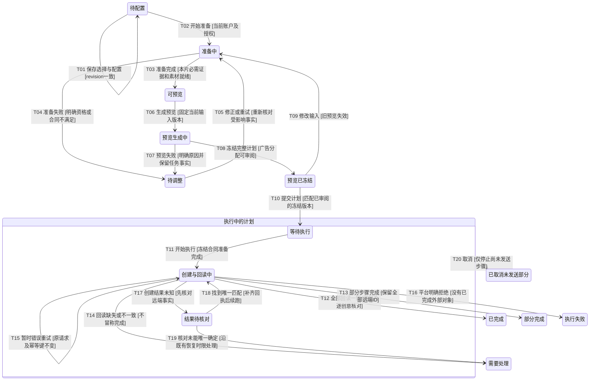

> Canonical Spec: [JB-5](https://linear.app/erplus/issue/JB-5/m1-spec已有-series-端原生直接视频投放闭环). 用户已确认；本地副本供实施，支持边界以该Spec为准。

# M1：已有 Series 直接视频投放闭环

> 文档状态：**规格已定稿：用户已确认主要验收Seam，广告组合沿用既有通用投放策略；尚未实现、未做真实广告验收**。
>
> MMF：M1。一个目标广告账户、一份已有 Series 资产、一组地区及一份直接视频计划，完成“选择 → 准备 → 预览 → 提交 → Campaign / Adgroup / Ad 与逐创意回读”。

## Problem Statement

### 用户问题

投放手已经拥有可投的 Series 资产、广告身份、视频和文案，但当前搭建主链以 MINI_APP / 推广链接为目的地，不能可靠表达 NATIVE_SERIES 直接视频投放。若只新增一个 `native_series_id` 输入框，会把以下不同事实混在一起，产生错误广告或不可恢复的外部副作用：

- 广告账户、Series 所属投放身份、创意展示身份是三个不同概念；同一业务剧目可以拥有多套身份与多份 Series 资产。
- Series 资产与地区计划绑定，不是全 BC 的业务剧目级唯一身份或地区配置。
- 直接 Series 与分销 Series 的目的地合同不同；直接模式不使用 `landing_page_url_list` 或 `distribution_link`。
- 官方SOP的30–50视频、6文案是可调整策略建议；用户确认沿用原项目的素材分配、基础广告及创意复制语义。原新建路径每个最终广告使用一条文案，API限制按单对象校验。
- 目标 ROAS 存在 Series / location 活跃占用约束，但当前可见目录、同步覆盖、跨账户 / BC 作用域和 `active` 完整状态并不足以支持“全域无冲突”承诺。
- 创建请求成功响应、UNKNOWN 超时和回读不一致是不同事实；只有外部对象及逐创意事实核对完成，用户才获得可用结果。

### MMF 判定

**判定：M1 是一个 MMF。**

1. **切成两半，是否存在两半各自能上线且有人用的切法？** 对本片完整创建任务没有找到这样的切法：身份/资产目录与素材准备是创建输入，仅预览不交付已创建结果；仅创建而没有冻结及回读不能核对目的地和内容。独立浏览目录的既有能力归Epic的M3，不为本片新建资产管理产品。
2. **整体是否可单独上线且有人用？** 是，但完整结果必须包括回读。用户针对一个账户、一份 Series 和一组地区，可以从已有资产得到一份明确冻结的直接视频计划，经具体授权提交后获得三级外部 ID 和逐创意核对结果。只有目录或只有预览，用户都没有得到已投放结果；只有创建响应，则无法确认 Series、身份、地区、视频、文案与 CTA 是否真实生效。

**本片风险与验证要求**：提交会创建 ENABLE 的外部对象并可能立即产生预算消耗；重复提交、UNKNOWN 后盲目重建、取消时误删旧对象都可能造成真实损失。因此冻结预览、幂等执行、UNKNOWN 恢复和回读必须属于同一 MMF。

### 本片输入与结果边界

| 项目 | M1 支持范围 |
|---|---|
| 租户 / BC / 路由 | 当前用户明确选择且经授权的租户、BC、连接及授权代数；不硬编码星屿或任何账户、身份、Series、秘密 |
| 广告账户 | 一个目标账户；不能由此推断跨账户没有占用 |
| 目的地 | 一份已有 `native_series_id`，直接模式；不为它伪造推广链接或业务剧目唯一键 |
| 身份 | 独立的 `series_identity` 与 `creative_identity`；数据模型允许二者不同，但未证实组合不能放行 |
| 地区 | 这份 Series 的一份非空地区集合；核对当前账户/版位支持和官方已知适用条件，不编造Series专属地区字段 |
| 策略 | 直接视频、Target ROAS、Campaign CBO、既有通用策略；首片工作流为 1 Campaign—1 Adgroup，不是永久平台限制 |
| 内容 | 视频、逐视频封面、文案和动态 CTA；30–50 视频、6 文案是可调整的策略预设，不是固定产品上下限 |
| 提交 | 用户确认具体冻结预览后，沿既有 `creation_status=ENABLE` 合同直接创建；不增加第二次激活流程 |
| 完成 | 三级对象与每个 API Ad 的视频、封面、文案、创意身份、CTA 均回读一致；否则是 `partial` / `needs_attention`，不是完成 |

## Solution

### 总体方案

复用现有“草稿选择 → SceneJob 准备 → Strategy 展开 → BuildPreview 冻结 → Submission / ExecutionRequest 执行 → Recovery / Readback”主链，在既有 Seam 上增加 NATIVE_SERIES 直接视频合同。不新建平行资格、目录同步、调度、执行、激活或业务 HTTP 网关。

核心数据形状是一个带 `kind` 的目标选择联合，而不是多个需要同步的布尔值或可选字段：

- `MINI_APP` 继续携带 Mini / link 事实。
- `NATIVE_SERIES_DIRECT_VIDEO` 携带 Series、Series 身份、地区及独立的创意身份。
- 每个分支只含该目的地合法字段；编译器和回读器按同一个 discriminator 工作。

### 沿用既有通用投放策略

广告组合以既有《通用投放策略设计》和当前Implementation为基线，复用同一套数量、素材分配和文案版本模型。

现有语义保持：

1. 先按广告组生成方式及素材共享/顺序均分规则，确定每组素材。本M1工作流仅一个广告组，不扩展为多组投放，也不改变其他场景的多组策略。
2. 组内按“固定基础广告数量”或“按素材数量及每广告素材上限”确定基础广告及素材分配；固定数量时仍可共用本组素材或顺序均分。
3. 每个基础广告再按creative_count生成文案版本：每个最终广告继承该基础广告的同一组素材，只更换文案。最终广告数等于基础广告数乘creative_count。
4. 文案池仍是候选池，沿用现有去空/去重、固定seed抽取及池不足报错规则；不是承诺将候选池全部文案与全部视频做笛卡尔积。本次实际选中的文案和素材分配完整冻结，提交后不重新抽样。
5. 预览计数与实际计划沿用同一策略规则，明确显示系列/组/最终广告数量和每条广告的素材及文案，不静默重拆、截断或修改已冻结结果。

示例：

- 30–50视频，固定1个基础广告并共用全部素材，creative_count=6且文案池至少6条：生成6条最终广告，每条使用相同视频集合及一条不同文案。
- 30个视频，按素材生成且每广告1素材，creative_count=1：生成30条最终广告。
- 2个基础广告，creative_count=3：生成6条最终广告；素材是否共用或均分由原策略决定。

这些是已有策略的不同配置实例，不是端原生专用模板或固定数量。API单广告最多50个视频的约束继续由既有规划/校验处理；本片普通新建每广告一条文案符合API合同。过大的单广告素材配置按既有错误反馈要求用户调整，不新增隐式拆单。CBO预算按Campaign计算，不随最终广告数量倍增。

### 身份资格策略

- `series_identity` 决定 Series 目录发现及组层承载 / 管理身份；`creative_identity` 写入每条创意的展示身份，二者不可互换。
- 不用分销模式的“同身份”要求反推直接模式，也不在数据模型或编译器中增加全平台同身份限制。
- 当前官方已读材料只证明两层身份语义不同，**没有证明直接模式下任意不同身份组合均可提交**。因此资格结果区分 `READY / BLOCKED / UNVERIFIED`；具体组合缺少匹配当前账户/资产/权限/版位的有效证据时返回 `UNVERIFIED`，原因码为 `native_series_identity_combination_unverified`，不得自动改成同身份。
- 两个身份ID相同本身也不证明已授权或可投；首片真实验收应选择有当前权限和直接模式有效证据的组合。这只是本片验收范围，不是永久平台规则。若首片必须支持不同身份组合，则该输入路径在补证前未就绪。

### 占用与平台拒绝策略

占用观察只来自当前授权账户的已有 Ads Directory 及其同步覆盖证据：

- 以 `native_series_id × location` 检查可见 Campaign / Adgroup；地区集合有交集即报告，不假设 ZIP、ROW 或地区层级天然无重叠。
- 返回 `visible_conflicts`、`coverage`、`observed_at`、`published_version` 和 `scope_limits`，并区分 `ACTIVE / INACTIVE / UNKNOWN`。
- 明确命中的同Series/重叠地区活跃冲突阻止提交，并定位对象和地区。目录覆盖不足、过期或状态无法确认时显示具体限制与潜在冲突，不标为“无冲突”，也不将未公开的全域规则自动变成新增产品门禁。
- 目录未覆盖时可通过现有 Directory Request 请求当前账户的同步，不另建同步器。该现有入口受ADS_SYNC_ENABLED和官方通道路由控制；关闭或同步尚未完成时如实保留覆盖未知，不改开关，不伪造已刷新，也不因此要求改变部署配置。
- 即使当前账户快照无冲突，也只能显示“当前授权账户截至该观察时间未发现已知冲突”。跨账户 / BC、快照后的并发变化和平台内部资格仍由平台最终判定。
- 不自动停旧、改地区、换身份、换 Series 或降低 ROAS；平台拒绝保留原始错误并进入既有失败 / 部分成功处理。

## Business Flow

### 持久状态图

以下是用户关心的业务状态，映射到既有Draft、SceneJob、Preview和Submission事实；不是新增平行执行状态机。准备/预览的失败细节保留在原任务和generation中。



T01包含资产与两层身份的原子选择、素材/文案和策略保存。T04中的暂时读取错误可保持准备中并按现有资源/页码有界重试。T05/T06复用现有失败预览的revision/generation合同，不增加新的自动重建路径。T09不会改写旧冻结历史。T16若已有外部对象，按T13记录部分完成而非无外部影响失败。T20是用户取消动作的投影：已有外部对象或UNKNOWN时保留partial/needs_attention及恢复事实，不能宣称已撤销；图中的取消状态不等于干净的Submission.cancelled。未列出的业务转移不因本片开放。

### 转移、owner 与持久事实

| T | 转移与行为 | 唯一 owner Module | 关联 R |
|---|---|---|---|
| T01 | 原子保存目标、两层身份、地区、素材、文案和策略；revision增加且受影响准备失效 | Build Drafts | R01–R05, R09, R13 |
| T02 | 冻结当前路由，创建/复用SceneJob及资源分页任务 | Scene Preparation | R01–R05, R10 |
| T03 | 本片实际可取得的关键证据及目标账户视频/封面就绪 | Scene Preparation | R03–R06, R10 |
| T04 | 暂时准备失败沿原任务重试；明确不可用/无权限记录原因并待调整 | Scene Preparation | R03–R06, R10 |
| T05 | 修正后重新准备受影响scope，或恢复原失败资源，不误用旧失败事实 | Scene Preparation | R03–R05, R10 |
| T06 | 固定draft revision、内容、策略与占用观察，开始预览展开 | Preview Expansion | R02, R06–R13 |
| T07 | 明确内容/请求合同缺失或已知活跃冲突时不冻结，不静默跳过 | Preview Expansion | R06–R12 |
| T08 | 保存完整广告分配、金额、身份、Series、地区、覆盖限制与digest | Frozen Requests | R07–R13 |
| T09 | 输入变化使旧冻结预览失效，历史请求保持原样 | Build Drafts | R02, R13 |
| T10 | 仅匹配FROZEN版本可提交，重复提交复用同一Submission | Build Execution | R13, R14 |
| T11 | 按冻结合同write-once准备并执行三级请求 | Build Execution | R09, R13–R15 |
| T12 | 三级及逐创意回读全部匹配才完成 | Readback Compare | R14, R15, R20 |
| T13 | 保留所有已建ID、失败/未发步骤与部分结果 | Build Execution | R14, R16, R20 |
| T14 | 回读缺失、多义或不一致进入需要处理，不覆盖真实外部对象 | Readback Compare | R20 |
| T15 | 暂时错误仅按现有预算重试原FrozenRequest | Build Execution | R14, R17 |
| T16 | 明确拒绝保留原始证据，无已建对象时失败；已有对象按T13处理 | Build Execution | R16 |
| T17 | 结果UNKNOWN进入只读核对，不盲目再次create | Build Recovery | R18 |
| T18 | 既有恢复合同唯一定位对象并核对配置，补齐回执后续跑 | Build Recovery | R18, R20 |
| T19 | 未找到、查询失败或多义按既有恢复窗口处理；未决不冒称成功 | Build Recovery | R18 |
| T20 | 活跃计划取消未发送本地步骤；保留已建/UNKNOWN外部事实 | Build Execution | R18, R19 |

### 规则

| R | 规则 | 唯一 owner Module | Participants |
|---|---|---|---|
| R01 | 所有输入与证据必须属于当前 tenant / BC / 冻结路由 / 授权代数和一个目标账户；不得使用硬编码账户、BC、身份或秘密 | Build Drafts | Accounts Capability Router, Scene Preparation, Material Readiness |
| R02 | 目的地使用 discriminator union；NATIVE_SERIES 必须有 Series / 两层身份 / 地区，MINI_APP 与 NATIVE_SERIES 的互斥字段不得混搭 | Build Drafts | Scene Preparation, Preview Expansion, Request Compiler, TikTok Build Contracts |
| R03 | Series 身份与创意身份分别授权、保存和回读；无证据的不同身份组合为 `UNVERIFIED`，不得自动替换或宣称任意组合可用 | Identity Selection | Accounts Capability Router, TikTok Accounts Capability Source, Scene Preparation |
| R04 | Series 必须在“当前账户 + Series 身份”的完整分页目录中精确可见，并身份通过其available/can-use/can-push检查，地区按账户/版位能力核对；身份字段不能伪装成Series列表字段，也不冒充全部经营资格 | Scene Preparation | Accounts Capability Router, TikTok Accounts Capability Source, Identity Selection |
| R05 | 地区属于当前 Series 资产计划；同一业务剧目可有多份 Series 与不同地区，不建立剧目级或全 BC 唯一身份 / 地区约束 | Build Drafts | Scene Preparation |
| R06 | 每个选中视频必须在目标账户有已核实 VID、封面和可用映射；任何缺失都使计划失败，不能沿用跳过素材后仍冻结的行为 | Material Readiness | Preview Expansion |
| R07 | 沿用既有素材分配、基础广告及creative_count文案复制语义；最终广告数=基础广告数×creative_count，保留原seed抽取和冻结结果 | Strategy Structure | Preview Expansion, Request Compiler, TikTok Build Contracts |
| R08 | M1 工作流产生 1 Campaign—1 Adgroup；直接 CBO 下同 Campaign 的组必须同 Series 与组层身份，但该 1:1 不是全系统永久限制 | Strategy Structure | Request Compiler |
| R09 | 预算使用 Decimal 与既有冻结精度；Target ROAS 使用 CBO 动态日预算、VALUE / AD_REVENUE_VALUE / VO_MIN_ROAS / ZERO_DAY / NO_BID，提交状态为 ENABLE | Request Compiler | Build Drafts, Strategy Structure, Preview Expansion, TikTok Build Contracts, Readback Compare |
| R10 | Scene 证据必须完整、未过期且匹配路由、授权、目的地和合同 revision；可恢复失败有界重试，关键证据缺失不得 READY | Scene Preparation | Accounts Capability Router, TikTok Accounts Capability Source |
| R11 | 占用结果必须带当前授权账户范围、目录覆盖和观察时间；已知活跃冲突阻止提交；覆盖不足或ACTIVE_UNKNOWN必须准确提示，不宣称全域无冲突，不把未知自动变成新增全局门禁 | Ads Directory | Preview Expansion, Build Execution |
| R12 | 本片精确保留所选Series与地区集合；不得自动停旧、改地区、换身份/资产，也不得把同名的不同Series误报为同一资产；M2多计划重复占用不在本片新增 | Preview Expansion | Ads Directory |
| R13 | 冻结内容包含全部意图、内容分配、路由 / 授权代数和资格 / 占用证据；输入变化使旧预览 OBSOLETE，重建同一冻结合同 hash 不漂移 | Frozen Requests | Build Drafts, Preview Expansion, Build Execution |
| R14 | 只有匹配的 FROZEN preview revision 可提交；同一预览重复提交复用 Submission 与稳定幂等键，直接 ENABLE，无第二激活 | Build Execution | Frozen Requests, Official SDK Build Adapter |
| R15 | 直接 NATIVE_SERIES 编译为 Campaign APP_PROMOTION + app_promotion_type=MINIS，Adgroup promotion_type=NATIVE_SERIES；写 Series / 组身份、逐创意身份、视频 / 封面、动态 CTA，并省略直链与分销字段 | Request Compiler | TikTok Build Contracts, Official SDK Build Adapter |
| R16 | 平台明确拒绝保存原始 evidence 和已创建 ID；不得自动重试相同拒绝、停旧或改变冻结意图 | Build Execution | Official SDK Build Adapter |
| R17 | 仅暂时错误可沿用现有有界退避与同一请求重试；预算、身份、地区、内容和幂等键不得变化 | Build Execution | Official SDK Build Adapter |
| R18 | UNKNOWN 表示外部结果未知；Recovery 沿既有只读发现与精确配置核验唯一定位对象，保留已见 ID，禁止未经既有显式恢复授权自动再次 create | Build Recovery | Build Execution, Official SDK Build Adapter |
| R19 | 取消只影响未发送本地步骤；已创建或 UNKNOWN 对象必须保留并核对，不能自动删除、停用或记为无外部影响 | Build Execution | Build Recovery |
| R20 | 完成前必须核对三级外部 ID 与全部冻结事实；NATIVE_SERIES 的 AD_REVENUE_VALUE 创建值只按本场景映射到 IMPRESSION_LEVEL_AD_REVENUE 回读值 | Readback Compare | TikTok Build Contracts, Build Execution |

## User Stories

1. **选择已有资产**：作为投放手，我能在一个已授权账户中选择具体 Series，看到 Series ID、名称、Series 身份和地区证据，而不是用业务剧目名称猜测资产。
2. **区分两层身份**：作为投放手，我能分别确认 Series 承载身份和创意展示身份；即使二者 ID 相同，也能看到它们承担的角色。
3. **理解未证实组合**：作为投放手，当直接模式下两层不同身份缺乏可用证据时，我看到“组合未核实”及补证条件，系统不替我改成同身份，也不谎称任意组合已支持。
4. **保留多资产边界**：作为投放手，同一业务剧目的另一份 Series 可以拥有不同身份与地区；本片选择不会覆盖那份资产，也不要求全 BC 唯一。
5. **获得可解释资格结果**：作为投放手，Series 不可见、不可用、不能推视频、地区不可用或证据不完整时，我看到具体原因和当前目录观察时间。
6. **恢复准备失败**：作为投放手，分页读取或授权暂时失败后，我可以从失败资源继续准备；修正选择后不会错误复用旧目录或旧失败。
7. **使用策略预设**：作为投放手，我可以从 30–50 视频、6 文案的 SOP 预设开始调整；系统不会把星屿历史 5 文案当成产品上限，也不会把 SOP 预算建议当成平台最低预算。
8. **确认完整内容**：作为投放手，我能在冻结前逐个看到已选视频、封面和文案；任何视频无法使用时，本批明确失败，而不是少投一条仍显示成功。
9. **沿用原策略搭建**：作为投放手，我继续按固定/按素材数量、共用/均分及创意数量配置广告，并在预览看到原策略计算的最终数量与分配。
10. **数量变化可解释**：作为投放手，我调整素材上限、基础广告数或创意数量时，预览按原规则更新；单广告超平台限制则明确报错，不暗中重拆。
11. **审阅预算与 ROAS**：作为投放手，我能在冻结预览中看到精确预算、Campaign CBO、Target ROAS、ZERO_DAY 与 ENABLE，不需要提交后再次激活。
12. **看到占用证据边界**：作为投放手，我能看到当前授权账户内的已知冲突、目录覆盖和观察时间，也看到“未检查其他账户 / BC，平台最终判定”的明确提示。
13. **处理冲突而不误操作**：作为投放手，已知活跃冲突或同批重复会指出对象与地区；系统不会替我停旧、换地区、换身份或换 Series。
14. **冻结后保持可审计**：作为投放手，草稿变化会让旧预览失效；我提交的 revision 与审阅内容完全一致，之后仍可追溯路由、授权和证据版本。
15. **提交不会被双击重复创建**：作为投放手，重复点击或网络重试同一冻结预览不会产生第二套 Campaign / Adgroup / Ad。
16. **跟踪三级进度**：作为投放手，我能看到 Campaign、Adgroup、每个 API Ad 和逐创意的 pending / sending / succeeded / failed / unknown 状态及真实外部 ID。
17. **理解平台拒绝**：作为投放手，平台因占用、资格或其他合同拒绝时，我看到原始错误与已完成部分；系统不会把拒绝包装成成功或擅自修改计划重试。
18. **安全恢复 UNKNOWN**：作为投放手，请求超时后会先只读查找真实对象；唯一匹配可续跑，多义或未决结果需要人工处理，不会直接重复创建。
19. **取消不制造假象**：作为投放手，取消只阻止尚未发送的步骤；如果 Campaign 已经创建，我会看到部分完成及外部 ID，而不是“已全部撤销”。
20. **获得真实完成结果**：作为投放手，只有三级对象及每个视频、封面、文案、创意身份和 CTA 都与冻结预览一致时，批次才显示 completed；否则我能看到差异并处理。

## Implementation Decisions

### 用户已确认的主要验收 Seam

**主要验收入口只有一条：现有创建工作区的“保存草稿 → 准备资产/素材 → 查看并冻结预览 → 提交 → 查看任务结果”用户流程。** 测试通过该流程真实使用的builds业务Interface运行，穿过实际SceneJob、策略展开、冻结、执行及回读；平台响应替身仅放在官方SDK Adapter的传输处。金额、锁和并发相关路径使用真实PostgreSQL/Redis。

验收既覆盖正常创建，也从同一入口注入身份/素材缺失、已知占用、平台拒绝、回读差异、重复提交、UNKNOWN和取消。断言最终广告分配、三级及逐创意ID/配置、幂等和可见结果，不以内部函数调用次数替代用户结果。真实广告写验收另需具体冻结预览授权，不能把传输替身成功当成平台已接受。

以下五处是既有内部Interface/Seam的复用位置，用于针对性合同和性质检查，不是五个需要投手分别理解或批准的验收入口：

1. Build Drafts / Identity Selection：带类型的目的地选择和原子revision。
2. Scene Preparation / Accounts能力目录：真实分页、身份及账户资格；Ads Directory保持对象同步owner。
3. Strategy Structure / Preview Expansion / Frozen Requests：沿用原计划生成、计数、文案抽取和冻结语义；本片不改变策略核心算法。
4. Request Compiler / TikTok Build Contracts / 官方SDK Adapter：合法目的地和字典正文序列化。
5. Build Execution / Build Recovery / Readback Compare：既有ENABLE、幂等、取消及未知结果恢复。

用户已确认上述端到端验收入口；广告组合明确沿用既有通用投放策略。本Spec据此定稿，按to-spec发布并标记ready-for-agent。

+++ Agent notes · Module 与 Interface

### Module 与 Interface

以下均为现有 Module 的演进；**新增 Module 数为 0**。签名是合同草图，不是实现代码。

#### Build Drafts

- Owns：T01、T09；R01、R02、R05。

```python
@dataclass(frozen=True)
class MiniAppSelection:
    kind: Literal["MINI_APP"]
    link_id: UUID
    minis_id: str
    creative_identity: IdentitySelection

@dataclass(frozen=True)
class NativeSeriesSelection:
    kind: Literal["NATIVE_SERIES_DIRECT_VIDEO"]
    advertiser_id: str
    native_series_id: str
    series_identity: IdentitySelection
    creative_identity: IdentitySelection
    region_codes: tuple[str, ...]

SceneSelection: TypeAlias = MiniAppSelection | NativeSeriesSelection

def update_draft(session: Session, *, context: TenantContext, draft_id: UUID, selection: SceneSelection, expected_revision: int) -> DraftPreparationResult: ...
```

- Ensures：R01, R02, R05, R09, R13。
- `scene_selection` 是身份与目的地唯一事实源；旧 `selected_identity` 不得与新的两层身份并行写入。
- `region_codes` 非空且保序去重；重复输入必须可见反馈，不静默改变用户选择。

#### Identity Selection

- Owns：R03。

```python
class CombinationReadiness(Enum):
    READY = "READY"
    BLOCKED = "BLOCKED"
    UNVERIFIED = "UNVERIFIED"

@dataclass(frozen=True)
class NativeSeriesIdentityChoice:
    series_identity: IdentitySelection
    creative_identity: IdentitySelection
    readiness: CombinationReadiness
    reason_codes: tuple[str, ...]
    evidence_ids: tuple[UUID, ...]

def choose_scene_identities(session: Session, *, context: TenantContext, draft_id: UUID, selection: SceneSelection, expected_revision: int) -> ScenePreparation: ...
```

- Ensures：R01, R03, R04。
- 两层身份在一次 draft revision 中原子保存；选择后重新准备对应账户 / Series scope。
- `UNVERIFIED` 不是 `READY`，也不是平台永久禁止。

#### Accounts Capability Router

- Owns：无独占T/R；作为R01、R03、R04、R10参与方。

```python
def prepare_identity_directory(
    session: Session, *, context: TenantContext, advertiser_id: str, identity_filters: IdentityFilters, route: FrozenTikTokRoute
) -> IdentityDirectoryPreparation: ...

def prepare_native_series_directory(
    session: Session, *, context: TenantContext, advertiser_id: str, series_identity: IdentitySelection, route: FrozenTikTokRoute
) -> ScenePreparation: ...
```

- Ensures：R01, R03, R04, R10。
- 混合 `TT_USER / BC_AUTH_TT` 必须分别完整分页，不能让单类型 cursor filter 错滤另一类。
- 只调度现有目录 / 能力准备，不拥有 Series 资格判定或广告执行。

#### TikTok Accounts Capability Source

- Owns：无独占T/R；作为R03、R04、R10参与方。

```python
@dataclass(frozen=True)
class NativeSeriesRecord:
    native_series_id: str
    series_identity: IdentitySelection  # 本页请求scope，不伪装为返回字段
    name: str
    cover_url: str | None
    evidence_id: UUID

@dataclass(frozen=True)
class NativeSeriesPage:
    items: tuple[NativeSeriesRecord, ...]
    next_cursor: str | None
    complete: bool

def list_native_series_page(
    context: TenantContext, *, advertiser_id: str, series_identity: IdentitySelection, cursor: str | None
) -> NativeSeriesPage: ...
```

- Ensures：R03, R04, R10。
- 复用官方 SDK 适配层通用分页能力；原始未知字段可保留为证据，但不凭字段名猜测资格。
- Series记录只映射官方实际返回的ID、名称和封面等资产字段，不要求不存在的Series available/地区字段。`available_status`、`can_use_series`、`can_push_video`从独立身份响应取得并保留来源；地区来自账户/版位能力。尚未公开的Series资格不虚构为已检查或新增必填字段。

#### Scene Preparation

- Owns：T02–T05；R04、R10。

```python
SceneResource: TypeAlias = Literal[
    "account_roles", "identity", "native_series", "minis", "cta", "vbo", "regions", "budget"
]

@dataclass(frozen=True)
class SceneContext:
    destination: SceneSelection
    supported: bool
    reason_codes: tuple[str, ...]
    capability_revision: int
    campaign_fields: Mapping[str, object]
    adgroup_fields: Mapping[str, object]
    creative_fields: Mapping[str, object]
    evidence_ids: tuple[UUID, ...]
    expires_at: datetime


def prepare_scene(session: Session, *, context: TenantContext, advertiser_id: str, selection: SceneSelection, route: FrozenTikTokRoute) -> ScenePreparation: ...
def read_scene_context(session: Session, *, context: TenantContext, advertiser_id: str, selection: SceneSelection, route: FrozenTikTokRoute) -> SceneContext: ...
```

- Ensures：R01–R05, R10。
- Scene scope basis 包含目的地类型、账户、Series、Series 身份、路由 / 授权代数、媒体与合同 revision；创意身份仍进入最终上下文与冻结 digest。
- `native_series` 使用现有 SceneJobPage 保存完整分页证据；不伪造 link 或 minis。

#### Material Readiness

- Owns：R06。

```python
@dataclass(frozen=True)
class SelectedVideoAsset:
    material_id: UUID
    video_id: str
    cover_web_uri: str
    content_digest: str

def require_selected_video_assets(
    session: Session, *, context: TenantContext, advertiser_id: str, material_ids: tuple[UUID, ...], route: FrozenTikTokRoute
) -> tuple[SelectedVideoAsset, ...]: ...
```

- Ensures：R01, R06。
- 返回数量、顺序和 material ID 必须与选中集一致；继续使用现有实际账户素材映射与新鲜度 / VID 校验。
- 任一映射缺失、未确认或封面缺失都抛出稳定 reason code，不返回缩短列表。

#### Strategy Structure

- Owns：R07、R08。复用现有Module及Interface，本片不修改数量/分配/文案抽取算法；M1工作流在消费方限制本片一个组的范围。

```python
@dataclass(frozen=True)
class AdCreativePlan:
    base_ad_no: int
    unit_ids: tuple[UUID, ...]
    copies: tuple[CopyChoice, ...]

@dataclass(frozen=True)
class GroupCreativePlan:
    group_no: int
    unit_ids: tuple[UUID, ...]
    ads: tuple[AdCreativePlan, ...]

@dataclass(frozen=True)
class NativeSeriesFrozenAdPlan:
    base_ad_no: int
    creative_no: int
    video_assets: tuple[SelectedVideoAsset, ...]
    copy: CopyChoice
    creative_identity: IdentitySelection
    cta_portfolio_id: str


def plan_structure(units: Iterable[NamedCreativeUnit], *, config: StrategyConfig, pool: tuple[CopyChoice, ...], seed: int) -> tuple[GroupCreativePlan, ...]: ...
def estimate_batch_structure(unit_counts: Iterable[int], *, account_count: int, config: StrategyConfig) -> StructureEstimate: ...
```

- Ensures：R07、R08、R09。上面两个函数是原Interface，不为原生目的地增加新的分支参数。
- Preview沿用“遍历基础广告、再遍历copies生成最终广告”的原流程，将返回的素材和已抽取文案逐项冻结；已冻结内容不重新抽样。
- 计数及实际计划继续共用现有结构规则；固定seed和相同策略输入产生稳定分配，重建已冻结请求仍消费原冻结事实。
- 空输入、池不足、无效均分及单广告超过50素材沿用现有错误；显式复制的创意单元不按内容摘要误合并。

#### Ads Directory

- Owns：R11。

```python
class OccupancyState(Enum):
    ACTIVE = "ACTIVE"
    INACTIVE = "INACTIVE"
    UNKNOWN = "UNKNOWN"

@dataclass(frozen=True)
class DirectoryCoverage:
    complete: bool
    observed_at: datetime | None
    published_version: int | None
    scope_limits: tuple[str, ...]

@dataclass(frozen=True)
class NativeSeriesOccupancy:
    coverage: DirectoryCoverage
    visible_conflicts: tuple[AdObjectRef, ...]
    state: OccupancyState


def observe_native_series_occupancy(
    session: Session, *, context: TenantContext, route: FrozenTikTokRoute, advertiser_id: str, native_series_id: str, region_codes: frozenset[str]
) -> NativeSeriesOccupancy: ...

def request_directory(session: Session, *, tenant_id: UUID, bc_id: str, frozen_route: Mapping[str, object], actor_id: UUID, advertiser_ids: tuple[str, ...], scope: Literal["targeted"]) -> int: ...
```

- Ensures：R11, R12。
- 使用现有 `AdObject`、已发布目录版本和 Directory Run 覆盖；Adgroup 的 Series / location 必须关联父 Campaign 状态。
- `UNKNOWN` 不能当成无冲突；当前账户无冲突也不能改写成跨账户 / BC 无冲突。

#### Preview Expansion

- Owns：T06、T07；R12。

```python
@dataclass(frozen=True)
class NativeSeriesPreviewFacts:
    selection: NativeSeriesSelection
    strategy_version_id: UUID
    api_ads: tuple[NativeSeriesFrozenAdPlan, ...]
    occupancy: NativeSeriesOccupancy
    api_ad_count: int


def generate_preview(session: Session, *, context: TenantContext, draft_id: UUID, expected_revision: int) -> UUID: ...
def load_frozen_unit(session: Session, *, context: TenantContext, unit_id: UUID, contract_revision: str | None = None) -> FrozenUnit: ...
```

- Ensures：R02, R06–R09, R11–R13。
- Preview 的 Series 快照不能依赖可变 PromotionLink；目标事实使用与 `SceneSelection` 相同的 tagged union。
- 每个PlannedAd仍对应原策略中一个基础广告的一个文案版本；api_ads来自这份确定计划，执行不另算数量，不追加隐式跳过素材。

#### Frozen Requests

- Owns：T08；R13。

```python
def freeze_request(*, intent: CreateIntent, scene: SceneContext, revision: FrozenRequestRevision) -> FrozenRequest: ...
def rebuild_frozen_request(session: Session, *, context: TenantContext, request_id: UUID, expected_revision: str) -> FrozenRequest: ...
```

- Ensures：R13, R14。
- 新 NATIVE_SERIES 序列化必须提升 `FrozenRequestRevision`；旧 revision 仍按旧 decoder 读取。
- digest 包含两层身份、Series、地区、原策略确定的最终广告分配、预算 / ROAS、路由 / 授权代数及证据 revision。

#### Request Compiler

- Owns：R09、R15。

```python
def compile_request(
    kind: Literal["CAMPAIGN", "ADGROUP", "AD"], *, fixed: FrozenUnit, resolved: SceneContext
) -> CreateIntent: ...

def decode_observed_intent(*, kind: Literal["CAMPAIGN", "ADGROUP", "AD"], body: Mapping[str, object]) -> CreateIntent: ...
```

- Ensures：R02, R07–R09, R15。
- 编译器只编码已冻结 `api_ads`，不再改变广告数量、内容分配、身份或地区。
- NATIVE_SERIES direct 省略 `landing_page_url_list`、`distribution_link`、`call_to_action_list`、`interactive_add_on_list`；MINI_APP 既有合法路径不能因此变成无链接。

#### TikTok Build Contracts

- Owns：无独占T/R；作为R02、R07、R09、R15、R20参与方。

```python
@dataclass(frozen=True)
class NativeSeriesAdGroupCreate:
    native_series_id: str
    series_identity: IdentityFields
    promotion_type: Literal["NATIVE_SERIES"]
    optimization_goal: Literal["VALUE"]
    optimization_event: Literal["AD_REVENUE_VALUE"]
    deep_bid_type: Literal["VO_MIN_ROAS"]
    vbo_window: Literal["ZERO_DAY"]
    bid_type: Literal["BID_TYPE_NO_BID"]
    location_ids: tuple[str, ...]

@dataclass(frozen=True)
class DirectSeriesVideoAdCreate:
    ad_format: Literal["SINGLE_VIDEO"]
    creative_list: tuple[VideoCreative, ...]  # 1..50，逐创意身份/视频/封面
    ad_text_list: tuple[str, ...]             # 本片普通新建为1条，API合同上限仍为5
    cta_portfolio_id: str

CreateIntent: TypeAlias = CampaignCreate | MiniAppAdGroupCreate | NativeSeriesAdGroupCreate | MiniAppAdCreate | DirectSeriesVideoAdCreate
```

- Ensures：R02, R07, R09, R15, R20。
- 不把现有 `minis_id`、`landing_page_url` 简单改成可随意为空的公共字段；互斥合法性由 union 保证。
- ObservedFacts 使用同等 discriminated 形状，缺字段不能被请求值补齐。

#### Official SDK Build Adapter

- Owns：无独占T/R；作为R14–R18参与方。

```python
class BuildOperations(Protocol):
    def create(self, *, kind: BuildKind, body: Mapping[str, object], idempotency_key: str) -> ExternalOperationReceipt: ...
    def read_page(self, *, query: BuildReadQuery) -> BuildPage: ...
```

- Ensures：R14–R18。
- 保持现有官方固定 pin SDK 与 dict body 透传；契约测试必须证明 `native_series_id` 和所需版位字段没有被生成模型丢弃。
- Adapter 只分类传输 / 平台错误并保留 evidence，不决定换身份、换地区或再次创建。

#### Build Execution

- Owns：T10、T11、T13、T15、T16、T20；R14、R16、R17、R19。

```python
def create_submission(session: Session, *, context: TenantContext, preview_id: UUID, expected_preview_revision: int, request_id: UUID) -> Submission: ...
def prepare_request(session: Session, *, context: TenantContext, request_id: UUID, expected_revision: str) -> FrozenRequest: ...
def process_step(session: Session, *, context: TenantContext, step_id: UUID, generation: int) -> ExecutionStep: ...
def submission_action(session: Session, *, context: TenantContext, submission_id: UUID, action: Literal["cancel", "retry"], reason: str) -> Submission: ...
```

- Ensures：R11（保留提交后竞争拒绝）, R13–R20。
- 沿用 Submission、ExecutionStep、ExecutionRequest、ExecutionFacts 和 write-once FrozenRequest。
- `completed` 只能由全部回读 MATCH 驱动；创建 HTTP 成功不是完成条件。

#### Build Recovery

- Owns：T17–T19；R18。

```python
def request_recovery(session: Session, *, context: TenantContext, request_id: UUID, reason: str) -> RecoveryRequest: ...
def process_recovery(session: Session, *, context: TenantContext, recovery_id: UUID, generation: int) -> RecoveryResult: ...
```

- Ensures：R18, R19。
- 沿既有对象发现键、父子关系及配置核对得到唯一匹配才补回执；本地intent hash用于关联冻结意图，不假定TikTok提供按该hash搜索的接口。多义、查询失败或超期不自动create。
- 只有现有 `authorize_create_after_unknown` 的人工恢复合同可另行授权后续动作；本片不新增恢复旁路。

#### Readback Compare

- Owns：T12、T14；R20。

```python
def compare_build(*, intent: CreateIntent, observed: BuildRecord) -> ReadbackComparison: ...
def compare_optimization_event(
    *, destination_kind: str, requested: str, observed: str
) -> Literal["MATCH", "MISMATCH"]: ...
```

- Ensures：R09, R20。
- Campaign：APP_PROMOTION/MINIS、CBO、动态日预算与ENABLE；目标ROAS配置在Adgroup核对，不要求Campaign返回不存在的组字段。
- Adgroup：Series ID、Series 身份、地区、版位、排期、VALUE / VO_MIN_ROAS / ZERO_DAY / NO_BID，以及直接模式无分销链接。
- Ad：每个实际 creative 的视频 / 封面 / 创意身份、文案多重集合、动态 CTA 和无直链；列表可无序，但不得按数组位置错配封面与视频。
- `AD_REVENUE_VALUE → IMPRESSION_LEVEL_AD_REVENUE` 只适用于本 NATIVE_SERIES 回读合同；不得顺手改变其他场景映射。

### 错误与反馈合同

| reason code | 含义与允许动作 |
|---|---|
| `native_series_not_found` | 当前账户 + Series 身份完整目录中无此 ID；重新选择，不用同名资产替代 |
| `native_series_unavailable` / `native_series_video_unavailable` | 平台可见资格为否；修正资产 / 授权后重新准备 |
| `native_series_regions_unavailable` | 账户/版位能力或官方明确Series适用条件不支持所选地区；不编造资产地区列表，只由用户修改地区 |
| `native_series_identity_combination_unverified` | 直接模式两层身份组合缺证据；保持 UNVERIFIED，不自动换身份 |
| `native_series_material_incomplete` | 任一选中视频 / 封面 / VID 缺失；本批失败，不跳过 |
| `native_series_copy_plan_incomplete` | 原策略展开结果与预览/冻结数量或文案不一致；拒绝冻结 |
| `native_series_occupancy_unverified` | 目录覆盖/观察时间/active证据不足；保留可见提示，可请求既有同步，不标为无冲突 |
| `native_series_target_roas_occupied` | 当前可见范围有活跃冲突；显示对象与地区，不自动改旧对象 |
| `native_series_readback_mismatch` | 外部事实与冻结意图不同；进入 needs_attention，不改写请求历史 |

+++

## Testing Decisions

### 测试总原则

- 确定性单元 / 合同测试不调用真实 TikTok 广告接口；外部替身放在官方 SDK 传输边界。
- 幂等、锁、恢复与并发使用真实 PostgreSQL / Redis 集成测试；预览、编译、执行和回读测试与真实调用者经过同一 Interface。
- 本片新增 Module 为 0，因此“删除新 Module”测试不适用；若实现引入平行执行器、同步器或资格 owner，设计审查应拒绝。
- 当前仅完成 Spec 与轻量一致性检查；以下测试均未因本 Spec 的产出而视为已执行或通过。

+++ Agent notes · T/R 检查与形式验证范围

### T 覆盖矩阵

下表优先从主要端到端Interface检查，针对分页、编译、性质和竞争的细节在既有内部Seam补充；不因存在内部检查而把用户流程拆成五个独立验收入口。

| T | 可检查映射 | 覆盖 R |
|---|---|---|
| T01 | 保存后资产/两层身份/地区/内容/金额及revision原子回读；混带目的地字段拒绝 | R01–R05, R09, R13 |
| T02 | 准备任务含真实账户、身份及Series scope、路由和分页资源 | R01–R05, R10 |
| T03 | 身份及目录证据、账户视频和封面就绪可预览；不要求API未提供的字段 | R03–R06, R10 |
| T04 | 读取暂时错误有界重试；明确不可投/无权限显示原因 | R03–R06, R10 |
| T05 | 修改Series或授权后受影响准备重建，不沿用旧scope或失败 | R03–R05, R10 |
| T06 | 冻结输入版本后生成唯一结构计划，计数与内容分配一致 | R02, R06–R13 |
| T07 | 选中内容缺失、请求超限或已知活跃冲突不能冻结；覆盖未知显示提示而非无冲突 | R06–R12 |
| T08 | 原策略配置1基础广告、creative_count=6显示6个最终广告；素材与文案冻结后可回读 | R07–R13 |
| T09 | 修改身份/Series/地区/内容/金额使旧预览失效，原事实不改写 | R02, R13 |
| T10 | 同一FROZEN版本双击/重放只生成一个Submission | R13, R14 |
| T11 | 三级请求来自冻结意图，重复prepare不改hash或分配 | R09, R13–R15 |
| T12 | 正常路径只有所有三级/逐创意核对一致才完成 | R14, R15, R20 |
| T13 | Campaign成功而子步骤失败时保留ID与部分结果 | R14, R16, R20 |
| T14 | 缺失/错误资产、身份、视频、封面、文案或CTA不能显示完成 | R20 |
| T15 | 暂时错误重试原请求及稳定幂等键，超现有预算转处理 | R14, R17 |
| T16 | 明确拒绝保存证据且不自动改计划或再次create | R16 |
| T17 | create超时后先只读核对，未决期间不重复create | R18 |
| T18 | 唯一对象且配置匹配可补回执续跑；对象定位不依赖虚构平台hash接口 | R18, R20 |
| T19 | 查询失败/多义/未找到沿既有窗口处理；未授权不再次create | R18 |
| T20 | 发送前取消无外部写；已有对象/UNKNOWN保留真实事实，不称全部撤销 | R18, R19 |

### R 覆盖与反错误实现检查

| R | 测试层级与必须能拒绝的错误实现 |
|---|---|
| R01 | 合同 + 集成：跨 tenant / BC / 账户 / 授权代数全部拒绝；两套不同 BC fixture 走同一代码路径，拒绝硬编码星屿 ID |
| R02 | 参数化合同：缺 Series、混带 Mini link、直接模式带 distribution link、空身份 / 地区均 ValidationError；两个合法 union 分支各自通过 |
| R03 | 合同 + 目录集成：交换两层身份会改变 scope / digest；未授权或不同组合无证据时 UNVERIFIED；混合身份分页不得漏掉任一类型 |
| R04 | 分页合同：同 ID 在错误身份下不可见、身份available/can-use/can-push为否、缺页或账户/版位明确不支持地区均阻断；资产目录不提供资格/地区字段时不得编造必填检查；只有第一页不得冒充完整目录 |
| R05 | 领域单元：同一业务剧目的两个 Series 可分别选择不同身份 / 地区；任何按剧名或全 BC 强约束唯一身份的实现失败 |
| R06 | 素材集成：选中 N 条必须返回同 N 条同顺序；缺 VID、封面、确认映射或跨账户 VID 时整批失败，拒绝“跳过后继续” |
| R07 | 复用策略回归：1基础广告×6创意=6最终广告，2×3=6，按素材数量生成遵循原规则；共用/均分、固定seed抽文案及池不足行为不变；预览数量/分配等于冻结及执行；错误修改创意倍数、素材分配或文案抽样的实现必须失败 |
| R08 | 结构 + 编译：M1正常计划为1个Campaign、1个Adgroup，广告数量由既有策略计算；同 Campaign 混入不同 Series / 组身份必须拒绝；不得把 1:1 写成其他场景永久约束 |
| R09 | Decimal / 编译 / 回读：`Decimal("1000.01")` 不经 float、不漂移；零 / 负预算拒绝；CBO、动态日预算、ROAS 四字段和 ENABLE 缺任一即失败 |
| R10 | Scene 集成：过期、错路由、错授权、错目的地 / revision 均不 READY；暂时失败从原资源页重试，畸形证据不能靠重试变 READY |
| R11 | Directory 集成：覆盖PARTIAL/STALE或ACTIVE_UNKNOWN准确提示，不能解释成无冲突或自动新增全局禁投；当前账户已知活跃交集阻断并定位；保留跨账户/BC scope limit |
| R12 | Preview 单元：所选Series和地区原样进入冻结意图；同名不同Series不能误报同一资产；已知冲突不得触发停旧/换身份/换地区等调用。多计划重复占用留M2验收 |
| R13 | 冻结性质：任一身份、Series、地区、视频、文案、预算或证据变化改变 digest；旧 preview 失效；同 revision 重建 hash 完全一致 |
| R14 | 真实 DB 幂等：双击 / 重试同一 preview 只有一个 Submission、正常双击/并发重放不增加额外创建；允许的暂时错误重试遵守R17并复用稳定键；非 FROZEN / 错 revision 拒绝；无第二激活调用 |
| R15 | 官方合同 + Adapter：断言全部 NATIVE 字段、逐创意身份 / 视频 / 封面 / CTA 与直链 / 分销字段缺省；dict body 经 SDK 序列化后仍保留新增键 |
| R16 | 执行负向：明确平台拒绝后状态 failed / partial、evidence 和已建 ID 完整；Adapter create 次数不增加，且无停旧 / 改地区 / 换身份调用 |
| R17 | 暂时错误时间线：每次重试 body / digest / idempotency key 完全相同；超过当前尝试上限转 needs_attention，而非无限重试 |
| R18 | UNKNOWN 恢复时间线：create超时后先read；唯一对象经父子关系及配置核对匹配才补ID，多义不落成功，未找到且未到期保持 UNKNOWN；无既有显式授权不得再次 create |
| R19 | 取消时间线：发送前取消无 Adapter create；部分发送后只 skip 未发送步骤，无远端 delete / disable；有 UNKNOWN 时仍需恢复，不能记 cancelled |
| R20 | 回读消融：分别删 / 改 Series、两层身份、地区、封面、视频、文案、CTA、事件或加入直链，每项均不得MATCH，按实际情况返回MISMATCH或INCOMPLETE；合法NATIVE事件映射才MATCH |

### 金额、并发、重复副作用与不可逆步骤的形式验证

现有 `formal-verify-business-export` 只覆盖业务导出的 Decimal、冻结导出与 writer append，**不覆盖本片广告创建**。

本片需要另行通过 `create-formal-verification-skill` 建立针对 Build Submission 的验证范围，至少覆盖：

- R07：既有结构计划及文案版本在预览/冻结/执行之间不丢失、不改变；不要求重新形式建模整套既有策略；
- R09：Decimal 金额、预算归属与 ROAS 不变量；
- R11–R12：占用观察覆盖、并发竞争只能由平台拒绝兜底，不能宣称全局锁；
- R14、R16–R19：幂等、重复提交、平台拒绝、UNKNOWN、取消与不可逆外部副作用；
- R20：只有完整回读才可 completed。

**当前未创建该验证 skill，也未完成上述形式验证。** 常规测试通过不得被描述为这些性质已形式证明。

+++

### 真实验收门（未执行）

1. 只读验收：在已确定BC内由授权目录发现并准备具体账户/Series/身份/地区方案，必要时仅补充无法从现有来源取得的信息，核实目录、资格、素材、覆盖和预览；不包含广告写权限。
2. 写入验收：另需用户明确授权具体冻结预览、预算和 ENABLE 提交，才可沿既有创建合同执行一次。
3. 完成验收：回读三级 ID 与每个 API Ad / 创意；任何 UNKNOWN、partial 或 mismatch 都如实保留，不用 fixture 或 HTTP 200 冒充真实业务通过。

## Out of Scope

- M2 多 Series、多账户、多资产批量编排；本片只有一个账户、一份Series和一个广告组计划。
- Drama Center 发剧、剧集上传 / 维护、合同签署、变现开通、Series 创建或身份授权管理。
- M7a 分销 Series、`distribution_link` 投放；同身份分销规则不能移用于本片。
- M7b 轮播、图片素材和 Carousel 专属合同。
- M8 从既有 Campaign 复制；本片不读取来源 Campaign 作为创建模板。
- M4a / M4b 收益、D0 ROAS 达成、全域回流、赔付或经营报表；本片只读取搭建 / 状态事实。
- 自动经营规则、补贴资格 / 金额、自动停旧、改预算、改地区、换身份或换 Series。
- 独立目录管理界面或新的同步服务；本片只消费现有目录及其有界同步。
- 对全平台身份组合、跨账户 / BC 占用、地区层级 / ZIP 释放或 active 完整状态作未证实保证。
- 把首片 1 Campaign—1 Adgroup、30–50 视频、6 文案或现有工程安全上限写成全系统永久限制。
- 本 Spec 任务中的真实广告写入、凭据 / 生产配置修改、全量应用测试或形式验证工具实现。

## Further Notes

### 官方依据与证据边界

- 官方 SOP（已读 revision 4230）：https://bytedance.larkoffice.com/wiki/LztBwAquoiZMEDkVjWOcsNYdnAf 。支持已有 Series、直接 / 分销语义、1 Campaign—1 Adgroup—1 资产组、30–50 视频 × 6 文案策略及 ROI2 占用提醒；SOP 建议不等于 API 参数上限。
- Drama Series Campaign API：https://business-api.tiktok.com/portal/docs/create-an-upgraded-smart-mini-series-feed-campaign/v1.3 。
- Smart+ Adgroup / Ad API：https://business-api.tiktok.com/portal/docs/create-an-upgraded-smart-ad-group/v1.3 、https://business-api.tiktok.com/portal/docs/create-an-upgraded-smart-ad/v1.3 。本片采用已核实的 NATIVE_SERIES、Target ROAS、50 视频 / 5 文案与直接模式字段合同。
- 身份与 Series 目录：https://business-api.tiktok.com/portal/docs/get-the-identity-list/v1.3 、https://business-api.tiktok.com/portal/docs/get-the-available-tiktok-series-within-an-ad-account/v1.3 。目录可见与已有资格字段是必要证据，不冒充完整投放资格。
- 详细接入子 Wiki 当前无权限，不重试或更改授权；缺少的经营资格不能被本地推测替代。

### 技术 Unknown、影响与解除条件

| ID | Unknown | 对本片影响 | 解除条件 |
|---|---|---|---|
| U01 | 直接模式下不同 Series / 创意身份组合的完整条件 | 具体组合缺少当前scope有效证据时UNVERIFIED；模型不禁止不同身份，也不因ID相同就当作已验证 | 官方直接模式合同或经授权的账户级有效证据；在此之前不宣称任意组合支持 |
| U02 | SOP“同一账号”与 API advertiser / 身份 / BC 的准确指代，以及 SOP ROI2 ad group 与 API 目标 ROAS Campaign 约束的完整映射 | 占用反馈同时保留 SOP 风险提醒与 API 已证实事实，不合并成伪精确规则 | 官方术语 / 作用域说明；未解除前不扩大无冲突承诺 |
| U03 | `active` 完整状态、地区层级 / ZIP / ROW 重叠与占用释放时间 | 命中对象无法确定状态时显示UNKNOWN及潜在冲突；不虚构无冲突结论，不将未公开状态定义自动变成全局禁投 | 官方生命周期和地区语义；或按当前明确证据显示不确定范围，平台最终校验 |
| U04 | Series / location 占用是否跨账户 / BC 及其准确范围 | 当前只查授权账户；即使无可见冲突仍可能平台拒绝 | 官方作用域证据；不得为消 Unknown 扫描未授权账户 |
| U05 | Series 合同签署、免费模式、审核等经营资格是否均可由 API 完整读取 | 只承诺API实际返回的资产/身份事实与已知条件；未返回的完整经营资格不新增为本地必填字段，平台仍可能拒绝 | 官方资格接口 / 文档或账户级只读证据；缺证据不得虚构字段 |
| U06 | PineDrama 等版位的账户白名单与直接 Series 必需条件 | 不默认添加 PineDrama；需该版位而无证据时未就绪 | 当前账户能力证据与用户明确选择，不静默替换基础版位 |
| U07 | 固定 SDK 生成模型未声明全部 NATIVE 字段的发布兼容性 | 静态 dict 可透传但仍需固定 pin 合同测试，不能仅凭静态阅读宣称真实平台通过 | Adapter 序列化测试及后续获授权的真实验收 |

### 定稿确认与发布

1. 用户已确认一条端到端主验收Seam：创建工作区真实业务流程，外部替身仅在官方SDK传输处；广告组合沿用原策略。五处内部Seam只作支撑检查。
2. 本片仅开放有当前账户/资产/权限有效证据的身份组合；缺证据显示UNVERIFIED，不宣称任意组合可用，也不新增全平台同身份规则。未公开的平台资格继续由平台最终校验；此支持边界不要求用户替官方规则做选择。
3. 占用采用已知活跃冲突阻断、覆盖/状态未知如实提示及平台最终校验的合同；不以缺少全域保证新增未约定经营限制。不得用ready-for-agent掩盖U01–U06的支持边界。
4. 发布目标：主线程在 Linear workspace `refresh` 的 Junbo 公司 Team `JB`、Project `ads-decision-system`（P-JB-10）定向查重，再按项目约定发布本M1 Spec、链接已有本地Epic并回链回读；创建新的Epic issue不是本次M1发布的隐含要求。
5. 用户确认已落实，按本片明确支持边界定稿并添加ready-for-agent；该标签表示规格可交付实现，不表示实现、测试或真实投放已完成。平台未知的完整支持范围仍不被标为已证实。

### 主线程复核记录

本稿由用户指定Kimi K3.1 Pro生成，执行模型已由宿主读回确认。主线程保留原始稿后修正了MMF切分问题、Campaign枚举、Series响应与身份/地区证据的来源区分、业务状态图、主要验收Seam和Interface草图。当前20个T在图/owner表/测试矩阵一一覆盖，20个R在owner表及反错误实现检查覆盖，16个Python Interface草图可解析；这仅是文档一致性检查，不是应用测试或真实平台验收。

用户已确认主要验收入口，并要求广告组合沿用既有设计。按已授权to-spec流程查重并发布M1，不自动新增Epic issue，不实施产品代码。

### 用户最终确认

2026-11-12：用户确认复用完整创建工作区验收流程；广告组合、广告组结构以之前的设计为主。对应决策为复用通用素材分组、基础广告及creative_count文案版本规则。原生适配聚焦目的地、身份、场景资格、请求及回读。

### 规划与依据坐标

- 本地Epic v4：/tmp/tkada-native-series-20261112/epic-draft.md；M1范围交接：/tmp/tkada-native-series-20261112/handoff-mmf1.md。
- 产品代码基线af24c3b968b9fa5cdbd8c55c9e5df4f00478df6f；通用组合依据为已实施的《通用投放策略设计》（2026-10-04）及当前结构计划/预览Implementation。源码保持只读。
- 业务调研选择星屿BC，对应业务连接tiktok-ads-xingyu；本Spec通用化，不硬编码其账户、身份或Series，也不调用该连接进行写入。
